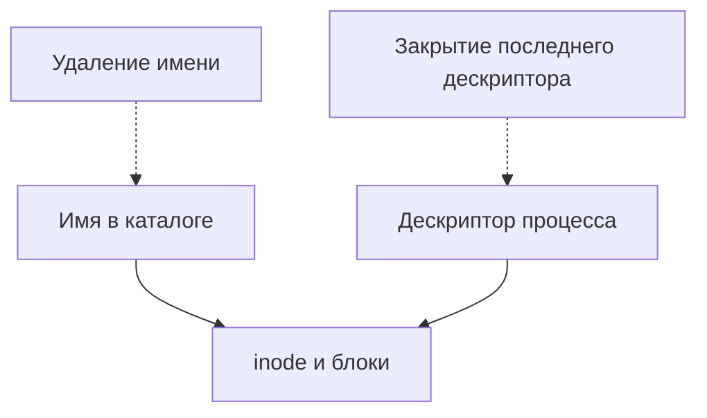
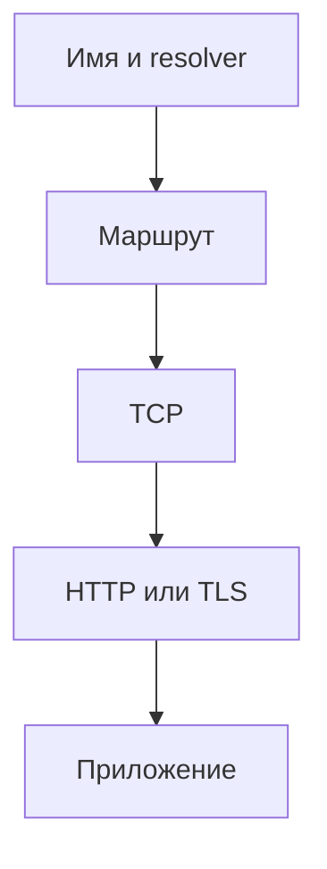

# Linux: продвинутая практика и разбор инцидентов

Продолжение [основного руководства](README.md). Для лабораторных используйте отдельную Linux VM и непривилегированного пользователя. Примеры ориентированы на Bash и systemd; доступность утилит зависит от дистрибутива. Команды с PID запускайте только для собственных учебных процессов. Перед публикацией выводов удалите адреса, имена пользователей и другие чувствительные сведения.

## Содержание

1. [Файловые дескрипторы и удалённые файлы](#1-файловые-дескрипторы-и-удалённые-файлы)
2. [Диагностика DNS и HTTP по слоям](#2-диагностика-dns-и-http-по-слоям)
3. [systemd: зависимость, готовность и остановка](#3-systemd-зависимость-готовность-и-остановка)
4. [Память: RSS, cache, swap и OOM](#4-память-rss-cache-swap-и-oom)
5. [CPU, очереди и cgroup v2](#5-cpu-очереди-и-cgroup-v2)
6. [Диск и задержки I/O](#6-диск-и-задержки-io)
7. [Bash: ошибки, временные файлы и блокировки](#7-bash-ошибки-временные-файлы-и-блокировки)
8. [Диагностика прав доступа](#8-диагностика-прав-доступа)
9. [Четыре практических инцидента](#9-четыре-практических-инцидента)
10. [План обучения и критерии](#10-план-обучения-и-критерии)

## 1. Файловые дескрипторы и удалённые файлы

Имя файла - запись каталога, ссылающаяся на inode. Процесс открывает файл через дескриптор. Удаление имени не закрывает уже открытый дескриптор; занимаемые блоки обычно освобождаются, когда исчезают ссылки и файл больше не открыт. Это одна из причин расхождения между `df` и `du`, наряду с mount points, правами и snapshots.



### Лабораторная: открытый удалённый файл

**Нужно:** Python 3, Linux, отдельная VM. В одном терминале запустите учебный процесс:

```bash
mkdir -p "$HOME/linux-lab/fd"
python3 -u - <<'PY'
import os, time
p = os.path.expanduser('~/linux-lab/fd/open-demo')
with open(p, 'wb') as f:
    f.write(b'x' * (1024 * 1024))
    f.flush()
    os.unlink(p)
    print(f'PID={os.getpid()}; файл удалён, дескриптор открыт', flush=True)
    time.sleep(120)
PY
```

Во втором терминале подставьте только выведенный PID:

```bash
ls -la "$HOME/linux-lab/fd"
ls -l /proc/УЧЕБНЫЙ_PID/fd
```

**Проверка:** файла по имени нет, один из дескрипторов указывает на удалённый файл. Через 120 секунд процесс закроет его; можно остановить именно этот учебный процесс Ctrl+C. Размер 1 MiB может быть слишком мал, чтобы изменение `df` было заметно. На реальном сервере не обнуляйте дескрипторы и не завершайте сервис без оценки влияния.

## 2. Диагностика DNS и HTTP по слоям



`getent hosts` использует настроенные механизмы разрешения имён, которые могут включать hosts и DNS. `ip route get` показывает выбранный ядром маршрут, а не факт доставки пакета. `ss` показывает сокеты в текущем сетевом пространстве имён. Успешный TCP connect не доказывает корректность ответа приложения.

### Лабораторная: 200, 404 и отказ соединения

```bash
mkdir -p "$HOME/linux-lab/net"
printf 'lab\n' > "$HOME/linux-lab/net/index.html"
python3 -m http.server 18765 --bind 127.0.0.1 --directory "$HOME/linux-lab/net" &
lab_http_pid=$!
```

```bash
getent hosts localhost
ip route get 127.0.0.1
ss -lnt | grep ':18765' || true
curl -i --max-time 3 http://127.0.0.1:18765/
curl -i --max-time 3 http://127.0.0.1:18765/missing
kill -TERM "$lab_http_pid"
wait "$lab_http_pid" 2>/dev/null || true
curl -i --max-time 3 http://127.0.0.1:18765/ || true
```

Запускайте блоки в одной shell-сессии: переменная хранит PID процесса. Если порт занят, выберите свободный и измените его во всех командах; не завершайте чужой процесс. **Проверка:** сначала 200, затем 404, после остановки - ошибка соединения. Если первый запрос случился до готовности сервера, повторите его после проверки `ss`. Запишите, какой слой подтвердил каждый результат.

### Таймауты и повторы

После timeout клиент не знает, выполнился ли POST: ответ мог потеряться после записи. Для изменений используйте поддерживаемый сервером ключ идемпотентности; ограничивайте число повторов, общий срок и добавляйте backoff с jitter. Идемпотентность требует серверной реализации, а не только заголовка.

## 3. systemd: зависимость, готовность и остановка

`After=` задаёт порядок, если оба unit запускаются, но не включает другой unit. `Wants=` и `Requires=` описывают зависимости с разными последствиями; часто их используют вместе с `After=`. Успешный запуск unit не равен готовности бизнес-функции. Тип `simple` считает сервис запущенным после старта процесса, `notify` позволяет приложению сообщить о готовности, если оно поддерживает протокол.

```bash
systemctl --user status linux-lab.service --no-pager
systemctl --user show linux-lab.service -p ActiveState -p SubState -p MainPID -p ExecMainStatus
journalctl --user -u linux-lab.service -b --since '15 minutes ago' --no-pager
```

Команды относятся к user-service из основного курса; сначала создайте и запустите его. Если нет пользовательского менеджера systemd, используйте полноценную VM-сессию. `-b` ограничивает текущей загрузкой, а данные журнала зависят от настроек хранения и прав.

**Эксперимент:** измените только учебный unit, указав несуществующий путь в ExecStart. Выполните `systemctl --user daemon-reload`, запустите unit и сопоставьте status и journal. Исправьте путь и проверьте HTTP. Очистите созданный unit по инструкции основного курса. Не редактируйте работающие системные службы.

При остановке сервису может потребоваться завершить активные запросы и закрыть ресурсы. `TimeoutStopSec=` ограничивает время остановки; после него поведение зависит от конфигурации unit. Проверьте реальный пользовательский запрос во время и после остановки: статус процесса сам по себе не подтверждает отсутствие потерянных операций.

## 4. Память: RSS, cache, swap и OOM

RSS приблизительно показывает физическую память страниц процесса, но сумма RSS разных процессов может многократно учитывать общие страницы. PSS распределяет общие страницы между процессами и доступна через `/proc/PID/smaps_rollup` при соответствующих правах. `MemAvailable` - оценка доступной памяти без существенного вытеснения, а не гарантия, что конкретное выделение удастся.

```bash
free -h
vmstat 1 3
cat /proc/pressure/memory
ps -eo pid,comm,rss --sort=-rss | head -n 10
```

Page cache ускоряет повторное чтение и может быть вытеснен при необходимости. Swap сам по себе не доказывает текущую проблему; важны скорость swap-in/out, давление памяти и задержка приложения. PSI показывает время, когда задачи задерживались из-за давления ресурса; доступность файлов зависит от ядра и окружения.

OOM kill может быть следствием лимита cgroup или нехватки памяти на хосте. Проверьте журнал ядра с доступными правами, события cgroup, причину завершения и временную связь с ростом памяти. Не отключайте OOM-защиту и не создавайте нагрузку на рабочем сервере. **Задание:** снимите два набора показателей с интервалом и объясните, что каждый показывает и чего не доказывает. Данные журнала могут содержать чувствительную информацию.

## 5. CPU, очереди и cgroup v2

Load average включает runnable задачи и задачи в непрерываемом ожидании; сравнивайте его с числом доступных CPU и метриками I/O. Ограничение CPU cgroup может вызывать throttling, даже когда на хосте в целом есть свободное CPU. Для процесса, ограниченного quota, `nproc`, affinity и настройки cgroup не всегда дают одинаковую картину доступной мощности.

```bash
nproc
uptime
vmstat 1 3
cat /proc/self/cgroup
cat /proc/pressure/cpu
```

Для cgroup v2 путь к группе определяется по `/proc/PID/cgroup` и точке монтирования cgroup2 из `findmnt -t cgroup2`. При наличии доступа `cpu.max` описывает quota и period, `cpu.stat` содержит счётчики throttling; сравнивайте **изменение** счётчиков за интервал. Среда контейнера может показывать относительный корень cgroup. Не предполагайте одинаковый путь на всех системах и не изменяйте лимиты для диагностики.

**Задание:** соберите данные дважды и сформулируйте две гипотезы для высокой задержки: ограничение CPU и ожидание I/O. Какие дополнительные измерения могут их опровергнуть? Средний процент CPU без метрик задержек ответа недостаточен.

## 6. Диск и задержки I/O

`df -h` показывает занятое пространство файловой системы, `df -i` - inode, а `du` суммирует видимые файлы. Полный диск и медленный диск - разные симптомы. Виртуализация, общая файловая система, кэш и сетевое хранилище меняют интерпретацию измерений.

```bash
findmnt -T "$HOME/linux-lab"
df -h "$HOME/linux-lab"
df -i "$HOME/linux-lab"
du -sh "$HOME/linux-lab"
cat /proc/pressure/io
```

При установленном sysstat используйте `iostat -xz 1 3` и изучите документацию своей версии. `await` - среднее время I/O в очереди и обслуживании; оно не показывает хвост задержек. Высокий `%util` не следует считать универсальным измерением оставшейся ёмкости для параллельных устройств. Сопоставляйте длительность запросов, очередь и метрики приложения. Не запускайте нагрузочные тесты на рабочем диске без согласования.

## 7. Bash: ошибки, временные файлы и блокировки

`set -e` имеет исключения, например в некоторых условиях и контекстах конвейеров. `pipefail` помогает увидеть неуспех этапа конвейера в Bash, но не заменяет явную обработку кодов. Всегда заключайте пути в кавычки; для перебора имён с пробелами и переводами строк используйте нулевые разделители.

### Лабораторная: безопасный разбор имён

```bash
mkdir -p "$HOME/linux-lab/names"
printf 'a\n' > "$HOME/linux-lab/names/file one.txt"
printf 'b\n' > "$HOME/linux-lab/names/file two.txt"
find "$HOME/linux-lab/names" -type f -print0 |
  while IFS= read -r -d '' file; do
    printf 'Файл: %s\n' "$file"
  done
```

**Проверка:** выведены два полных имени. Не используйте `for f in $(find ...)`: shell разобьёт результаты по пробелам и другим разделителям. В Bash цикл в pipeline часто выполняется в subshell, поэтому изменение переменной внутри него может не сохраниться снаружи.

Для временных файлов применяйте `mktemp`, проверяйте успех и удаляйте только собственный файл в `trap`. Для защиты от параллельных запусков часто подходит `flock`, но семантика зависит от файловой системы; блокировка должна охватывать весь критический участок. Изучите `man flock` перед применением.

## 8. Диагностика прав доступа

При ошибке Permission denied сначала определите пользователя и группы процесса, затем проверьте каждый каталог пути, файл, ACL, mount options и политику SELinux/AppArmor при их использовании. Для прохода по каталогу требуется execute; право записи в каталог влияет на изменение его записей. Исполняемый файл может быть недоступен из-за `noexec`, интерпретатора или политики безопасности.

```bash
id
namei -l "$HOME/linux-lab/permissions/data.txt"
stat "$HOME/linux-lab/permissions/data.txt"
findmnt -T "$HOME/linux-lab/permissions/data.txt"
```

Файл создаётся в разделе 4 основного руководства. При наличии `getfacl` проверьте ACL. **Упражнение:** создайте собственный учебный каталог, уберите у него право прохода для владельца, убедитесь, что файл недоступен, затем верните право. Не применяйте изменения к домашнему каталогу или рабочим данным. Запишите права до и после.

## 9. Четыре практических инцидента

### A. Диск заполнен, но du показывает меньше

1. Определите затронутый mount: `findmnt -T ПУТЬ`, `df -h ПУТЬ`, `df -i ПУТЬ`.
2. Сравните `du` в рамках нужной файловой системы и учтите недоступные каталоги.
3. При наличии прав и lsof проверьте открытые удалённые файлы: `sudo lsof +L1`.
4. Подтвердите владельца и влияние до действий; после согласованного восстановления повторите `df` и пользовательскую проверку.

### B. Сервис active, но HTTP не работает

Проверьте `systemctl status`, журнал, сокет и HTTP отдельно. Если сокет слушает только localhost, удалённый клиент не подключится. 404 означает, что ответил HTTP-компонент, но маршрут может быть неверным. Выясните, кто ответил: приложение или прокси. Восстановление проверяйте из той же точки, где возникает проблема.

### C. Резко выросла задержка

Зафиксируйте период, p95/p99 и долю ошибок. Сравните CPU throttling, PSI, I/O, память, очередь приложения и зависимость; проверьте недавний релиз. Сформулируйте хотя бы две конкурирующие гипотезы и способ опровергнуть каждую. Откат приложения не откатывает автоматически состояние базы.

### D. Подозрение на утечку файловых дескрипторов

Для **своего** учебного PID сравните число записей `/proc/PID/fd` в разные моменты. Рост - повод исследовать типы открытых объектов и нагрузку, а не доказательство утечки. Проверьте лимит в `/proc/PID/limits`, журнал и поведение после штатного завершения запросов. Не увеличивайте лимит бесконечно как замену устранению причины.

## 10. План обучения и критерии

| Неделя | Тема | Результат |
|---|---|---|
| 1 | Shell, файлы и права | Объяснить путь доступа и обработку ошибок |
| 2 | Процессы, сигналы и systemd | Запустить и восстановить учебный user-service |
| 3 | Сеть, DNS и HTTP | Отличить отказ соединения от HTTP-ошибки |
| 4 | CPU, память, I/O | Собрать наблюдения и сравнить гипотезы |
| 5 | Изоляция, безопасность и backup | Объяснить cgroups и протестировать восстановление |
| 6 | Инцидент и итоговый проект | Представить runbook и воспроизводимый отчёт |

После каждой работы сохраните команды, ожидаемый и фактический результат, причину отклонений и способ очистки. Для итогового отчёта опишите влияние, временную шкалу, доказательства, восстановление и профилактику. Не включайте секреты и реальные персональные данные.

## Документация

- [Linux man-pages: open(2)](https://man7.org/linux/man-pages/man2/open.2.html), [unlink(2)](https://man7.org/linux/man-pages/man2/unlink.2.html), [proc(5)](https://man7.org/linux/man-pages/man5/proc.5.html)
- [Документация ядра: PSI](https://docs.kernel.org/accounting/psi.html), [cgroup v2](https://docs.kernel.org/admin-guide/cgroup-v2.html)
- [systemd.unit](https://www.freedesktop.org/software/systemd/man/latest/systemd.unit.html), [systemd.service](https://www.freedesktop.org/software/systemd/man/latest/systemd.service.html)
- [Bash manual](https://www.gnu.org/software/bash/manual/), [Google SRE: troubleshooting](https://sre.google/sre-book/effective-troubleshooting/)
