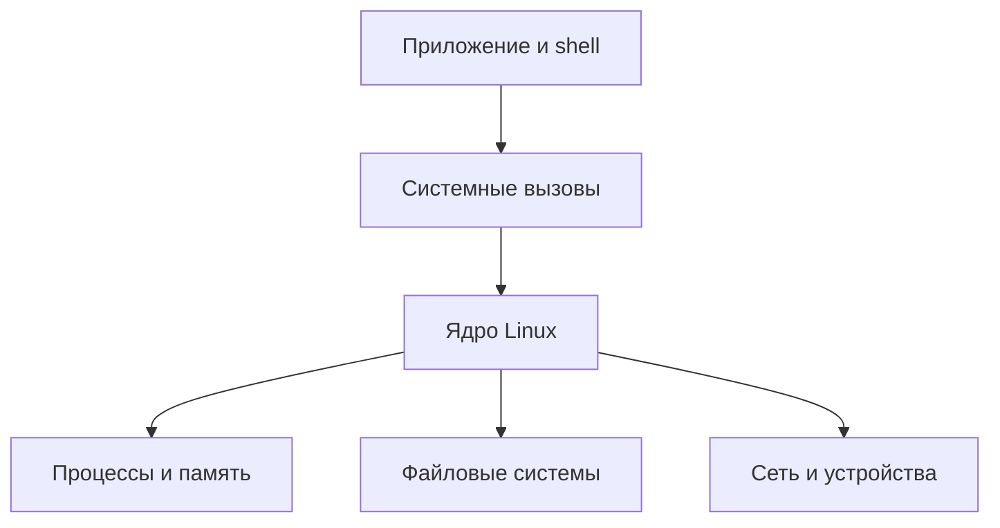
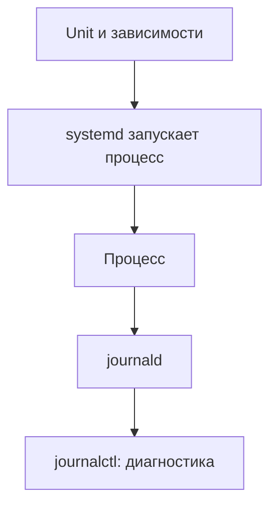
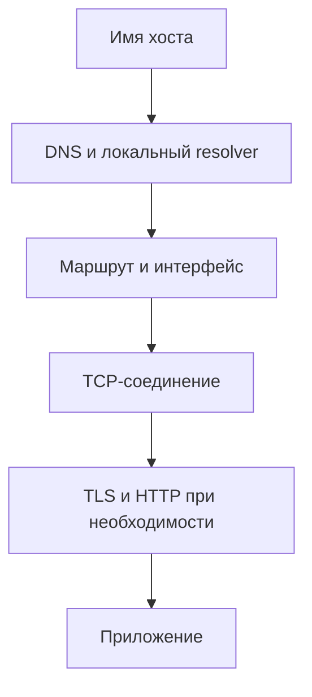

# Linux для DevOps-инженера

Практическое руководство на русском: от устройства системы и командной строки до диагностики отказов, systemd, сетей, безопасности и Linux-механизмов контейнеров. Цель - не запомнить набор команд, а научиться строить гипотезы, проверять их и безопасно восстанавливать сервис.

> **Формат:** теория → наблюдение → лабораторная → проверка → вопросы. Команды рассчитаны на Linux с Bash; примеры systemd - на системе с systemd. Дистрибутивы, версии утилит и права доступа различаются.

> Продолжение: [продвинутая практика и разбор инцидентов](ADVANCED.md) - файловые дескрипторы, cgroups, диагностика и учебные сценарии.

## Маршрут

| Раздел | Что научитесь делать | Практика |
|---|---|---|
| [1. Среда](#1-учебная-среда-и-безопасность) | Работать в изолированной VM | Снимок, инвентаризация |
| [2. Устройство Linux](#2-как-устроен-linux) | Различать ядро, процессы и системные вызовы | /proc, сведения о системе |
| [3. Shell](#3-shell-и-потоки) | Управлять потоками и кодами выхода | Фильтрация и ошибки |
| [4. Файлы и права](#4-файлы-и-права) | Диагностировать доступ и заполнение | chmod, inode, удалённые файлы |
| [5. Процессы](#5-процессы-и-сигналы) | Искать процессы и корректно завершать | PID, сигналы, лимиты |
| [6. systemd](#6-systemd-и-журналы) | Запускать и диагностировать сервис | Собственный user-service |
| [7. Сети](#7-сеть-и-dns) | Разбирать путь запроса | DNS, маршруты, сокеты |
| [8. Производительность](#8-производительность) | Находить насыщенный ресурс | CPU, память, диск, PSI |
| [9. Безопасность](#9-безопасность) | Выстраивать минимальные привилегии | Аудит доступа |
| [10. Пакеты и обновления](#10-пакеты-и-обновления) | Проверять происхождение и планировать обновления | Инвентаризация |
| [11. Автоматизация](#11-bash-и-автоматизация) | Писать воспроизводимые сценарии | Скрипт диагностики |
| [12. Контейнеры](#12-linux-под-контейнерами) | Понимать namespaces и cgroups | Исследование ограничений |
| [13. Хранилище и backup](#13-хранилище-и-восстановление) | Различать разделы, FS и копии | Тест восстановления |
| [14. Инциденты](#14-инциденты-и-runbook) | Действовать по симптомам и проверять результат | Три сценария |
| [15. Итоговый проект](#15-итоговый-проект) | Собрать портфолио | Сервис, runbook, отчёт |

## 1. Учебная среда и безопасность

Используйте отдельную VM с актуальным дистрибутивом Linux и systemd, непривилегированным пользователем, доступом к sudo и снимком состояния. Подойдёт Ubuntu Server или другая совместимая система. На macOS команды ниже выполняются **внутри Linux VM**, а не в терминале macOS. Контейнер не заменяет полноценную VM для лабораторных по systemd и загрузке.

Проверяйте имена хостов, контекст, устройства и пути до изменений. Не запускайте примеры от root без необходимости. Не практикуйте изменение firewall, SSH, разделов, удаление файлов или нагрузочные тесты на чужих и рабочих системах. Команды вывода могут содержать чувствительные данные: проверяйте их перед публикацией.

```bash
whoami
hostname
uname -r
cat /etc/os-release
id
pwd
```

**Лабораторная:** запишите дистрибутив, версию ядра, имя пользователя и тип окружения. Создайте каталог `mkdir -p ~/linux-lab` и перейдите в него. Сделайте снимок VM средствами вашей платформы и убедитесь, что знаете, как восстановить его.

## 2. Как устроен Linux



Ядро управляет ресурсами и предоставляет системные вызовы. Дистрибутив объединяет ядро, библиотеки, пакетный менеджер и пользовательские инструменты. Shell - программа, запускающая другие программы; PID 1 в VM с systemd управляет системными службами. `/proc` и `/sys` предоставляют интерфейсы к данным ядра и не являются обычным хранилищем файлов на диске.

```bash
ps -p 1 -o pid,comm,args
cat /proc/uptime
cat /proc/loadavg
getconf PAGESIZE
```

**Проверка:** определите PID 1 и время работы. Load average отражает среднее число задач, готовых выполняться или находящихся в непрерываемом ожидании, в том числе I/O; это не процент загрузки CPU. Сравнивайте его с количеством доступных CPU и другими метриками.

## 3. Shell и потоки

У процесса есть стандартный ввод (0), вывод (1) и поток ошибок (2). Конвейер передаёт stdout одной команды на stdin следующей; stderr по умолчанию остаётся отдельным. Код выхода 0 обычно означает успех.

```bash
printf '%s\n' 'api ok' 'worker error' 'api error' > ~/linux-lab/events.txt
rg 'error' ~/linux-lab/events.txt 2>/dev/null || grep 'error' ~/linux-lab/events.txt
grep 'api' ~/linux-lab/events.txt | wc -l
cat ~/linux-lab/events.txt > ~/linux-lab/copy.txt
printf 'exit=%s\n' "$?"
```

Перенаправление `>` перезаписывает файл, `>>` дописывает. Всегда заключайте переменные с путями в двойные кавычки: без них shell выполняет разбиение слов и раскрытие шаблонов. Для временных файлов используйте `mktemp`; не помещайте пароли в команды, историю и логи.

**Лабораторная:** посчитайте строки с `error`, сохраните результат отдельно и проверьте содержимое исходника. Запустите `grep 'missing' ~/linux-lab/events.txt` и посмотрите `echo $?`: grep обычно возвращает 1 при отсутствии совпадений, что не означает сбой чтения файла.

## 4. Файлы и права

Путь проходит через каталоги, каждому из которых требуется право traversal (x). У файла права r/w/x относятся к владельцу, группе и остальным; ACL, mount options и механизмы безопасности могут добавлять ограничения. Для каталога x даёт право прохода, а w вместе с x - возможность менять записи каталога. Это отличается от права записи содержимого файла.

```bash
mkdir -p ~/linux-lab/permissions
printf 'hello\n' > ~/linux-lab/permissions/data.txt
chmod 600 ~/linux-lab/permissions/data.txt
ls -ld ~/linux-lab/permissions
ls -l ~/linux-lab/permissions/data.txt
stat ~/linux-lab/permissions/data.txt
namei -l ~/linux-lab/permissions/data.txt
```

**Проверка:** владелец имеет чтение и запись, остальные - нет. `namei -l` помогает увидеть права на компонентах пути. Для ACL при наличии утилиты используйте `getfacl`. Не применяйте `chmod -R 777` для исправления ошибки доступа: сначала определите пользователя процесса, владельца, каталог и требуемые права.

### Почему диск заполнен, хотя файлов мало

`df -h` показывает использование файловой системы, `df -i` - inode; `du` суммирует пространство видимых файлов. Удалённый файл, который всё ещё открыт процессом, может занимать место до закрытия дескриптора. Разные mount points, права и snapshots тоже влияют на сравнение.

```bash
df -h ~/linux-lab
df -i ~/linux-lab
du -sh ~/linux-lab
findmnt -T ~/linux-lab
```

При расследовании в своей VM `sudo lsof +L1` может показать открытые удалённые файлы. Не завершайте неизвестные процессы и не обнуляйте их дескрипторы без оценки влияния. Корректное действие зависит от приложения и плана восстановления.

**Задание:** создайте в учебной папке два файла и символьную ссылку, сравните `ls -li` и `stat`. Объясните различие символьной и жёсткой ссылки и почему inode может оставаться занят после удаления имени.

## 5. Процессы и сигналы

Процесс имеет PID, родителя, окружение, открытые дескрипторы и ограничения. Потоки одного процесса разделяют ряд ресурсов. Zombie - завершившийся процесс, чей статус ещё не забран родителем; его нельзя «убить» повторно, поскольку он уже завершён.

```bash
sleep 300 &
lab_pid=$!
ps -o pid,ppid,stat,etime,args -p "$lab_pid"
ls -l "/proc/$lab_pid/fd"
kill -TERM "$lab_pid"
wait "$lab_pid"; printf 'status=%s\n' "$?"
```

SIGTERM можно обработать для корректного завершения; SIGKILL нельзя перехватить или игнорировать. Не начинайте диагностику с SIGKILL: сначала проверьте владельца и влияние, затем по возможности запросите штатное завершение. Скрипт выше работает только со своим учебным процессом.

**Мини-разбор:** `ps` - снимок, `top` - изменяющееся представление, `/proc/PID/status` - свойства конкретного процесса. Команды могут видеть разные пространства PID и иметь ограничения прав.

## 6. systemd и журналы

Unit описывает управление ресурсом. `enable` настраивает запуск при определённом событии или цели, `start` запускает сейчас; это разные действия. `active` не гарантирует, что пользовательский запрос работает. `After=` задаёт порядок, но само по себе не создаёт зависимость.



### Лабораторная: user-service без root

Нужен работающий user manager systemd. В обычной VM с пользовательской сессией проверьте `systemctl --user status`; если он недоступен, выполните задание в полноценной пользовательской сессии, не меняя системные настройки наугад.

```bash
mkdir -p ~/.config/systemd/user
cat > ~/.config/systemd/user/linux-lab.service <<'EOF'
[Unit]
Description=Linux lab HTTP server

[Service]
WorkingDirectory=%h/linux-lab
ExecStart=/usr/bin/python3 -m http.server 8765 --bind 127.0.0.1
Restart=on-failure

[Install]
WantedBy=default.target
EOF
systemctl --user daemon-reload
systemctl --user start linux-lab.service
systemctl --user status linux-lab.service --no-pager
curl -I http://127.0.0.1:8765/
journalctl --user -u linux-lab.service -n 20 --no-pager
systemctl --user stop linux-lab.service
```

**Проверка:** HTTP-ответ есть во время работы, после stop порт закрывается. Если `python3` установлен по другому пути, найдите его через `command -v python3` и поправьте ExecStart. Сервис раздаёт файлы учебного каталога только на localhost, не содержит аутентификации и не предназначен для production.

**Поломка:** измените путь ExecStart на заведомо неверный в учебном unit, выполните daemon-reload и start, изучите status и journal. Исправьте путь, проверьте запрос и остановите сервис. После задания удалите только созданный unit и выполните daemon-reload.

## 7. Сеть и DNS



`127.0.0.1` относится к текущему сетевому пространству. Прослушивание `0.0.0.0` означает все доступные IPv4-интерфейсы этого пространства; это не адрес назначения. DNS-ответ не гарантирует доступность порта, а успешный TCP connect - корректность HTTP-ответа.

```bash
ip -br addr
ip route
ss -lnt
getent hosts localhost
curl -sv --connect-timeout 2 --max-time 5 http://127.0.0.1:8765/ -o /dev/null
```

Последний запрос предполагает запущенный учебный сервис из работы 6. `ss -lntp` может показывать процессы только при достаточных правах. Не интерпретируйте `timeout` как доказательство firewall: проверьте маршрут, слушатель, фильтрацию и нагрузку. `connection refused` часто означает отсутствие слушателя или активный reject; HTTP 404 уже подтверждает, что HTTP-компонент ответил.

**Лабораторная:** при запущенном сервисе найдите его порт и выполните curl. Остановите сервис и сравните ошибку. Запишите, на каком этапе завершился каждый запрос.

## 8. Производительность

Начинайте с симптома и временного окна. Сопоставьте нагрузку, задержки, ошибки и недавние изменения. Метод USE предлагает проверить для ресурсов использование, насыщение и ошибки; RED - частоту запросов, ошибки и длительность для сервиса.

```bash
uptime
vmstat 1 3
free -h
ps -eo pid,comm,%cpu,%mem --sort=-%cpu | head -n 12
cat /proc/pressure/cpu
cat /proc/pressure/memory
cat /proc/pressure/io
```

Файлы PSI доступны не везде. PSI показывает долю времени, в течение которого задачи испытывали задержки из-за нехватки ресурса; `some` и `full` имеют разные определения. Используйте их вместе с контекстом. Большой cache в `free` сам по себе не означает нехватку памяти: важны доступная память, reclaim, swap и задержки. Высокий load average может включать задачи в непрерываемом ожидании I/O.

При наличии `sysstat` полезны `iostat -xz 1 3` и `pidstat 1 3`; в минимальном образе их может не быть. `strace` и perf способны влиять на систему и раскрывать данные: применяйте по разрешению и с ограниченной областью. Не запускайте синтетическую нагрузку на production без согласованного плана.

**Задание:** снимите три последовательных наблюдения vmstat без дополнительной нагрузки. Определите, какие поля относятся к runnable задачам, памяти и ожиданию I/O по `man vmstat`. Почему одна высокая цифра не доказывает причину медленного сервиса?

## 9. Безопасность

Принцип наименьших привилегий: отдельная учётная запись для службы, минимальные права на файлы и сеть, ограниченный sudo и управляемая ротация секретов. Не размещайте секреты в Git, аргументах процесса или логах. Переменные окружения тоже могут быть доступны другим процессам с подходящими правами и попадать в дампы.

```bash
id
umask
sudo -l
find ~/linux-lab -maxdepth 2 -type f -perm -o+w -print
```

Не отключайте firewall, SELinux/AppArmor или SSH-аутентификацию ради прохождения упражнения. SSH-ключи проверяйте по отпечатку, ограничивайте доступ и предварительно проверяйте альтернативный вход перед изменениями. SELinux/AppArmor и Linux capabilities - дополнительные механизмы, а не замена правам файлов. Обновляйте систему и проверяйте происхождение пакетов.

**Задание:** нарисуйте матрицу «человек / CI / сервис → какие файлы и действия нужны». Найдите избыточные права в собственном учебном каталоге, исправьте только их и повторите проверку.

## 10. Пакеты и обновления

Пакетный менеджер разрешает зависимости и проверяет настроенные источники, но подходы и названия различаются между Debian/Ubuntu и RHEL-подобными системами. Не смешивайте команды двух семейств и не копируйте команды из непроверенных источников. Перед обновлением production нужны инвентаризация, проверка совместимости, резервная копия, окно изменений и план отката; обновление ядра может требовать перезагрузки.

```bash
cat /etc/os-release
command -v apt || true
command -v dnf || true
uname -r
```

**Практика:** определите семейство учебной VM, найдите в документации своего менеджера команду просмотра установленных пакетов и истории операций. Запишите версию запущенного ядра и объясните, почему она может отличаться от установленного нового ядра до перезагрузки.

## 11. Bash и автоматизация

Хороший эксплуатационный скрипт сообщает, что делает, явно проверяет ошибки и не меняет окружение неожиданно. `set -e` имеет исключения в условиях, конвейерах и других контекстах; оно не заменяет явную обработку ошибок. `pipefail` меняет статус конвейера в Bash, но не делает любую цепочку автоматически безопасной.

Создайте `~/linux-lab/report.sh`:

```bash
#!/usr/bin/env bash
set -u
set -o pipefail

printf 'host: %s\n' "$(hostname)"
printf 'kernel: %s\n' "$(uname -r)"
printf '\nFilesystem for lab:\n'
if ! df -h "$HOME/linux-lab"; then
  printf 'Cannot inspect lab filesystem\n' >&2
  exit 1
fi
printf '\nListening TCP sockets:\n'
if ! ss -lnt; then
  printf 'Cannot inspect sockets\n' >&2
  exit 1
fi
```

```bash
chmod 700 ~/linux-lab/report.sh
bash -n ~/linux-lab/report.sh
~/linux-lab/report.sh
```

**Проверка:** синтаксическая проверка успешна, отчёт содержит разделы и не меняет систему. Если установлен ShellCheck, выполните `shellcheck ~/linux-lab/report.sh`. Перед отправкой отчёта удалите чувствительные сведения. Для периодических задач используйте cron или systemd timer с явными путями, логированием и защитой от нежелательного параллельного запуска.

## 12. Linux под контейнерами

Namespaces ограничивают видимость определённых ресурсов, cgroups позволяют учитывать и ограничивать ресурсы, capabilities разделяют часть привилегий root. Контейнеры в одной Linux-среде используют общее ядро; это не отдельная VM. Монтирования, seccomp, LSM и пользовательские пространства имён дополняют изоляцию. Доступ к Docker socket может давать очень широкие полномочия на хосте.

```bash
readlink /proc/self/ns/pid
readlink /proc/self/ns/net
cat /proc/self/cgroup
```

В cgroup v2 `cpu.max` и `memory.max` могут задавать ограничения; путь и доступность зависят от среды. CPU quota может вызывать throttling, а превышение памяти - OOM kill. Не меняйте cgroups вручную на рабочем хосте.

**Задание:** если Docker уже установлен в учебной VM, сравните вывод `cat /proc/self/cgroup` на хосте и в непривилегированном учебном контейнере. Не запускайте контейнер с `--privileged` и не монтируйте сокет Docker. Объясните, почему одинаковые PID в разных пространствах имён не обязательно означают один процесс.

## 13. Хранилище и восстановление

`lsblk -f` показывает блочные устройства и файловые системы; `findmnt` - точки монтирования. Раздел, файловая система и точка монтирования - разные уровни. Не форматируйте и не размонтируйте устройства в этой лабораторной.

```bash
lsblk -f
findmnt -T "$HOME/linux-lab"
df -h "$HOME/linux-lab"
```

RPO - допустимая потеря данных во времени; RTO - целевое время восстановления. Сохранённый том или snapshot не обязательно независимая резервная копия. Проверка копии означает восстановление в отдельное место, проверку содержимого и измерение времени, а для баз данных - применение корректного механизма согласованного backup.

**Лабораторная:** создайте текстовый файл в `~/linux-lab`, скопируйте его в отдельный учебный каталог, измените оригинал и восстановите копию под новым именем. Сравните `sha256sum` копии и восстановленного файла. Это упражнение показывает проверку восстановления файла, но не является полноценной стратегией backup.

## 14. Инциденты и runbook

1. Зафиксируйте влияние и время, проверьте контекст и недавние изменения.
2. Снимите безопасные наблюдения: состояние сервиса, журнал, порт, ресурсы и доступность зависимости.
3. Сформулируйте несколько гипотез и проверку, которая может опровергнуть каждую.
4. Снизьте влияние согласованным действием, затем проверьте пользовательский сценарий и метрики.
5. Запишите хронологию, подтверждённую причину, ограничения доказательств и профилактику.

| Симптом | Первые проверки | Не делайте вывод заранее |
|---|---|---|
| Сервис не отвечает | status, journal, ss, локальный curl | Процесс active не доказывает работоспособность маршрута |
| Диск заполнен | df -h, df -i, du, findmnt, открытые удалённые файлы | Не удаляйте неизвестные каталоги и файлы |
| Всё медленно | uptime, vmstat, память, I/O, метрики приложения | Высокий load не всегда означает нехватку CPU |

**Сценарий 1:** остановите только учебный user-service и определите, почему curl не отвечает. Восстановите и проверьте HTTP.

**Сценарий 2:** создайте в учебной папке файл с ошибкой прав, найдите причину и исправьте только этот файл. Зафиксируйте права до и после.

**Сценарий 3:** намеренно укажите неверный ExecStart учебного unit. По журналу определите причину, восстановите корректный путь и проверьте сервис. Очистите только созданные учебные ресурсы.

## 15. Итоговый проект

Поднимите в отдельной VM собственный простой HTTP-сервис под отдельным непривилегированным пользователем или в user-service. Подготовьте unit, журналирование, сценарий проверки, документацию и план восстановления. Покажите:

- запуск, остановку, наблюдение и корректную диагностику неверной конфигурации;
- проверку порта и HTTP-ответа с объяснением, что каждая проверка доказывает;
- инвентаризацию CPU, памяти и файловой системы;
- тест восстановления учебного файла и измеренное время;
- runbook и отчёт хотя бы по одному намеренно созданному инциденту;
- очистку учебных ресурсов и отсутствие секретов в материалах.

**Критерии:** другой человек может воспроизвести действия; команды ограничены учебным окружением; вывод и ожидаемый результат различимы; в отчёте есть данные, подтверждающие причину и восстановление.

## Шпаргалка: что смотреть первым

| Вопрос | Команды |
|---|---|
| Где я и кто я? | `hostname`, `whoami`, `id`, `pwd` |
| Что запущено? | `ps`, `systemctl status ИМЯ`, `journalctl -u ИМЯ` |
| Кто слушает порт? | `ss -lntp` с необходимыми правами |
| Куда идёт маршрут? | `ip route`, `ip route get АДРЕС` |
| Что с памятью и CPU? | `free -h`, `vmstat`, `top`, PSI |
| Что с диском? | `df -h`, `df -i`, `du`, `findmnt` |
| Почему нет доступа? | `id`, `ls -l`, `namei -l`, ACL и политика LSM |

## Самопроверка

1. Почему удалённый файл может продолжать занимать место?
2. Чем `systemctl start` отличается от `enable`?
3. Почему `active` не гарантирует успешный ответ приложения?
4. Чем timeout отличается от connection refused и HTTP 404?
5. Почему высокий load average не всегда означает нехватку CPU?
6. Что изменится при удалении контейнера и что останется в отдельном томе?
7. Почему повтор операции после timeout способен создать дубликат?
8. Как доказать, что backup пригоден для восстановления?

## Источники и справка

- `man bash`, `man systemd.service`, `man journalctl`, `man ss`, `man proc` - документация установленной версии.
- [Linux man-pages](https://man7.org/linux/man-pages/), [документация ядра Linux](https://docs.kernel.org/), [PSI](https://docs.kernel.org/accounting/psi.html).
- [systemd: документация](https://www.freedesktop.org/wiki/Software/systemd/), [cgroup v2](https://docs.kernel.org/admin-guide/cgroup-v2.html).
- [Google SRE: troubleshooting](https://sre.google/sre-book/effective-troubleshooting/) и [service level objectives](https://sre.google/sre-book/service-level-objectives/).

Версии, набор команд и поведение зависят от системы. Сверяйтесь с документацией установленной версии и проверяйте любую команду, меняющую состояние, до её запуска.
